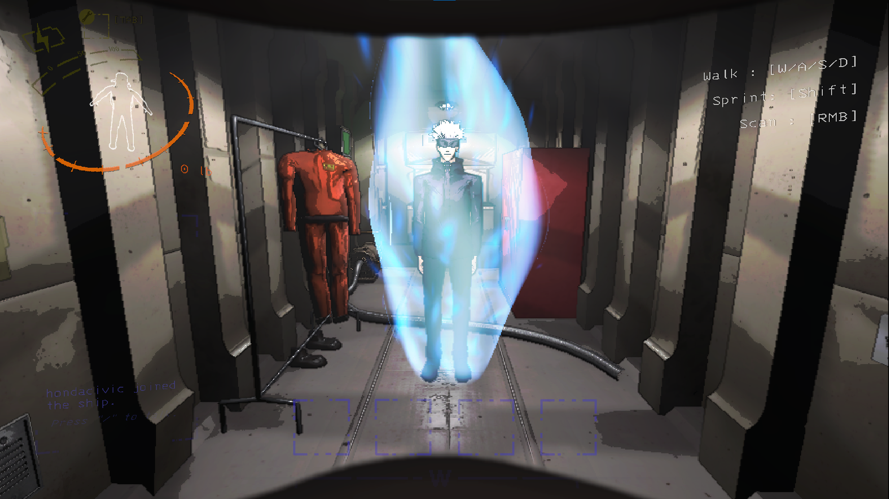

# GojoBracken

Gojo Satoru replaces the Bracken in Lethal Company v81. He follows the Bracken’s movements in a standing pose, and his blue aura grows stronger with anger. When the Bracken enters aggro, Gojo plays a Japanese voice line and the music starts. The music gets louder with anger and loops until aggro ends.

*Solo ship preview with the aura at full strength.*

## Credits

GojoBracken created by Malcolm Shi. Japanese voice line performed by Ashton Mak. See the [full asset credits](https://github.com/malcolmshi123/GojoBracken/blob/main/docs/release-assets.md).
