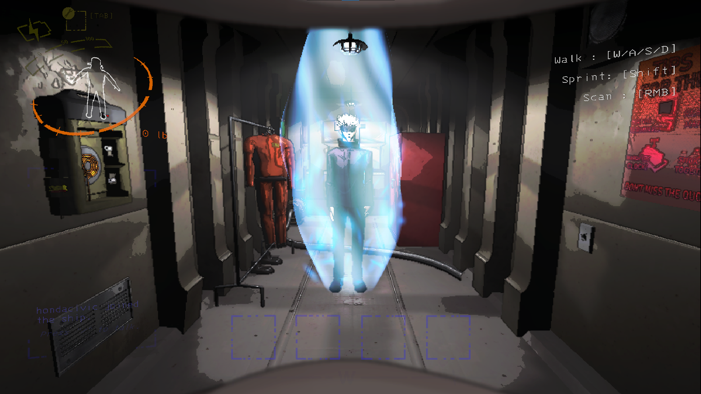

# GojoBracken

Gojo replaces the Bracken in Lethal Company v81. He holds a standing pose as he follows the Bracken's movements. His aura grows stronger with anger, and he plays a Japanese voice line when the Bracken enters aggro.

*Solo ship preview with the aura at full strength.*

- [Build or install the Thunderstore ZIP](docs/packaging.md)
- [Check asset credits and permissions](docs/release-assets.md)
- [Compile the plugin and export the Unity assets](docs/asset-pipeline.md)
- [Run the ship preview or test a live Bracken in solo play](docs/in-game-testing.md)
- [See how the mod loads assets, replaces the model, and handles the aura and voice](docs/runtime-behavior.md)
- [Check v81 compatibility, diagnostics, and regression tests](docs/game-compatibility.md)

Mod created by Malcolm Shi. Japanese aggro line recorded by Ashton Mak.

The code uses the [MIT license](LICENSE). See the [archive](archive/README.md) for the old guides and standalone preview.
